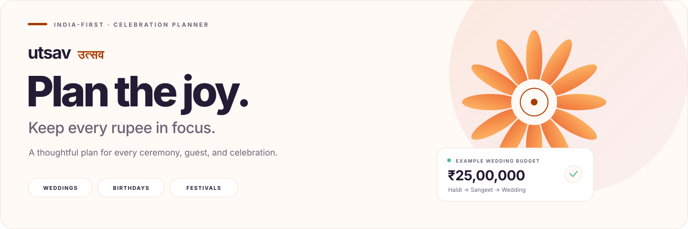
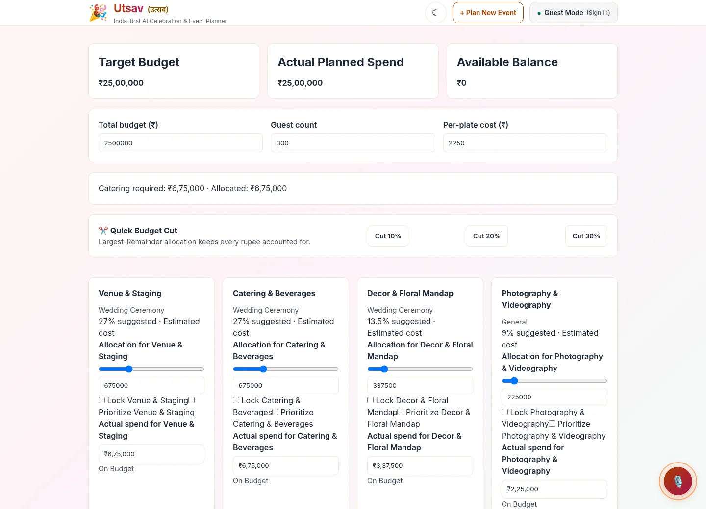
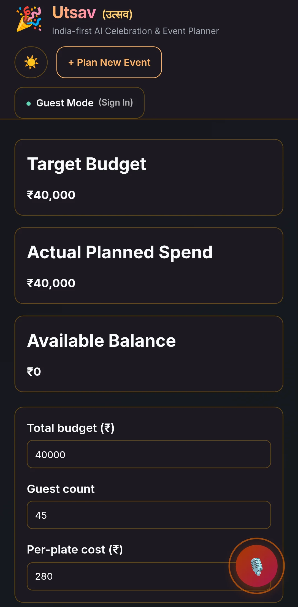
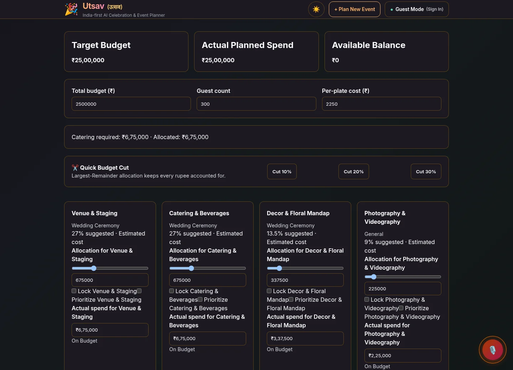
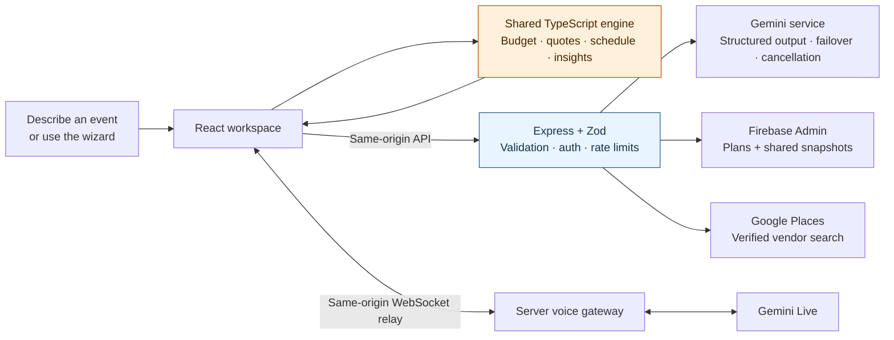

<a id="top"></a>

<div align="center">
  <picture>
    <source media="(prefers-color-scheme: dark)" srcset="docs/assets/banner-dark.svg" />
    
  </picture>

  <p><strong>Your people. Your traditions. One connected plan.</strong><br />
  Weddings, birthdays, and community festivals — with thoughtful AI and exact rupee math.</p>

  <p>
    <a href="https://github.com/rohilkohli/Utsav/actions/workflows/ci.yml"></a>
    <a href="#quick-start"></a>
    <a href="#under-the-hood"></a>
    <a href="#quality-you-can-check"></a>
  </p>

  <p>
    <a href="#see-the-planner"><b>Explore the UI</b></a> ·
    <a href="#quick-start"><b>Run locally</b></a> ·
    <a href="#choose-your-workflow"><b>Try a workflow</b></a> ·
    <a href="docs/DEPLOYMENT.md"><b>Deploy</b></a> ·
    <a href="#quality-you-can-check"><b>See the checks</b></a>
  </p>

<sub>Built for Hack2Skill × VirtualPromptWars · Challenge 5: Celebration &amp; Event Planner</sub>
</div>

---

## A celebration has a thousand moving parts. Your plan should connect them.

Utsav brings the budget, ceremonies, vendors, timeline, and day-of run sheet into one workspace. Change the guest count, accept a quotation, or delay a task: the connected plan updates with you.

| 💰 Every rupee accounted for                                                                                                              | 🗓️ Every ceremony in view                                                                                                        | 🤝 Every quote in context                                                                                             |
| :---------------------------------------------------------------------------------------------------------------------------------------- | :------------------------------------------------------------------------------------------------------------------------------- | :-------------------------------------------------------------------------------------------------------------------- |
| Exact integer allocations, category locks, priorities, catering estimates, contingency, and actionable budget cuts.                       | Dependency-aware milestones, delay propagation, compressed planning runways, assignees, and calendar exports.                    | Paste a quotation, inspect missing terms and risks, compare up to three options, and book with verified actual spend. |
| **✨ Help that knows your plan**                                                                                                          | **🇮🇳 Built around Indian celebrations**                                                                                          | **🔗 A plan the family can share**                                                                                    |
| Grounded questions in English, हिंदी, or Hinglish; plan reviews; creative ideas; streamed progress and voice interaction when configured. | Haldi, Mehendi, Sangeet, Pheras, regional food traditions, Indian number formatting, IST dates, and community permit checklists. | Start as a guest, recover your plan on refresh, optionally sign in, share a read-only snapshot, or print a summary.   |

> **Code owns the numbers. AI helps with the words.**
> Budgets, dates, dependencies, and tradeoffs come from deterministic TypeScript. Gemini handles creative suggestions, language, and structured extraction.

## See the planner

<picture>
  <source media="(prefers-color-scheme: dark)" srcset="docs/assets/planner-dark.webp" />
  
</picture>

<sub>Real application captures using a sample guest plan. The preview follows your light/dark preference; click an image to inspect it at full size.</sub>

<details>
<summary><strong>📱 Open the mobile preview</strong></summary>
<br />
<p align="center">
  
</p>
</details>

<details>
<summary><strong>🌗 Compare light and dark themes</strong></summary>
<br />

|                                        Light                                         |                                       Dark                                        |
| :----------------------------------------------------------------------------------: | :-------------------------------------------------------------------------------: |
| [](docs/assets/planner-light.webp) | [](docs/assets/planner-dark.webp) |

Both themes include visible keyboard focus and support reduced motion, increased contrast, and forced colors.

</details>

## Quick start

**Use Node.js 24 and npm.** Guest planning works without Google credentials.

```bash
git clone https://github.com/rohilkohli/Utsav.git
cd Utsav
npm ci
cp .env.example .env
printf '\nUSE_IN_MEMORY_STORE=true\n' >> .env
npm run dev
```

Open **http://localhost:5173**. Express runs on port **3001**; Vite forwards API and voice WebSocket requests to it.

Keep the example values for the first run. The exact Gemini example key selects curated fallback plans, and the example Firebase configuration keeps sign-in disabled. Local shared snapshots use memory and disappear when the server restarts; guest plans remain in that browser's storage.

<details>
<summary><strong>Windows / PowerShell setup</strong></summary>
<br />

After cloning, entering `Utsav`, and running `npm ci`:

```powershell
Copy-Item .env.example .env
Add-Content .env "`nUSE_IN_MEMORY_STORE=true"
npm run dev
```

</details>

<details>
<summary><strong>Connect Gemini, Firebase, or Google Places</strong></summary>
<br />

| Capability                                                                        | Configuration                                                                                                                                               |
| :-------------------------------------------------------------------------------- | :---------------------------------------------------------------------------------------------------------------------------------------------------------- |
| Creative plans, reviews, AI quotation extraction, multilingual answers, and voice | Set a server-side `GEMINI_API_KEY`. `GEMINI_MODEL` may specify a comma-separated priority list. Model availability depends on the connected Google project. |
| Google sign-in                                                                    | Replace the `FIREBASE_*` example values with your Firebase web configuration and authorize the application domain in Firebase Authentication.               |
| Persistent plans and shared snapshots                                             | Configure Firebase Admin Application Default Credentials and Firestore permissions. Remove `USE_IN_MEMORY_STORE=true` or set it to `false`.                 |
| Real vendor discovery                                                             | Set `GOOGLE_MAPS_API_KEY` and enable Places API (New).                                                                                                      |

The server exposes the public Firebase web configuration at runtime. Gemini and Places credentials stay on the server. Microphone use requires permission and a secure context, such as HTTPS or localhost.

Production requires Firestore and rejects in-memory storage. Follow the [deployment guide](docs/DEPLOYMENT.md) before enabling live services.

</details>

## Choose your workflow

Expand a card, try the steps locally, and watch the plan respond.

<details open>
<summary><strong>💍 Plan a wedding in one sentence</strong></summary>
<br />

Paste this into **Describe your celebration**:

```text
Wedding in Jaipur, 300 guests, budget 25 lakh, 15 December 2030,
Haldi + Sangeet + Wedding, pure veg, royal marigold theme
```

1. **Fill from description** takes you to a populated review step.
2. **Instant create** builds a local preset without a network request.
3. Use the five-step wizard whenever you want to choose every detail yourself.

For another event, try a birthday in Mumbai or a community festival with a shared meal. Choose a future date when adapting the example.

</details>

<details>
<summary><strong>💸 Make the budget fit the guest list</strong></summary>
<br />

Change **Guest count** or **Per-plate cost** on Budget Planner. Check the catering requirement and shortfall, then adjust allocations. Lock commitments, prioritize what matters, and inspect the exact redistribution.

When actual spending goes over budget, compare the three suggested tradeoffs. Accepted quotations remain visible as verified commitments. You can also ask the assistant to explain the options in plain language.

</details>

<details>
<summary><strong>📋 Turn a vendor message into a decision</strong></summary>
<br />

Open Vendor Checklist and paste a quotation:

```text
Vendor: Marigold Caterers
Total price: ₹1,80,000. GST included.
Minimum 300 guests. Advance 60%.
Cancellation: deposit is non-refundable.
```

Review extracted prices, missing information, and risk flags. Add up to three quotations to a category's comparison, copy a follow-up inquiry, and accept the best fit. Acceptance books the vendor and updates the matching budget's actual spend and verification state.

Local extraction remains available without Gemini. Unstated terms stay unknown instead of being invented.

</details>

<details>
<summary><strong>⏳ Handle a delay without losing the rest of the plan</strong></summary>
<br />

Open Timeline & Milestones, add delay days to a prerequisite, and inspect the downstream **Pushed by delayed task** indicators. Assign owners, mark work complete, or export the adjusted schedule as an `.ics` file.

For short planning windows, schedule compression adapts the preset runway. The Day-of Run Sheet keeps the actual celebration's tasks close at hand.

</details>

<details>
<summary><strong>💬 Ask, share, and hand over</strong></summary>
<br />

Ask **“What should I do next?”**, **“Kitna paisa bacha hai?”**, or **“अगला काम क्या है?”**. Source labels distinguish Gemini from the built-in planner.

Create a read-only share link, send the prepared WhatsApp message, or print the summary for your family. Shared snapshots expire after 30 days; local in-memory snapshots also end when their server stops.

</details>

## Under the hood



| Layer         | Tools                                    | Responsibility                                                                                |
| :------------ | :--------------------------------------- | :-------------------------------------------------------------------------------------------- |
| Interface     | React 18, Vite, accessible CSS           | Wizard, dashboard, dark mode, sharing, and voice controls                                     |
| Shared engine | TypeScript, Zod 4                        | Exact allocations, quotation math, dependency scheduling, schemas, and offline answers        |
| API           | Express, Helmet, Firebase Admin          | Authenticated persistence, same-origin guards, payload limits, and runtime configuration      |
| AI            | Google GenAI SDK                         | Structured creative output, quotation extraction, reviews, multilingual assistance, and voice |
| Checks        | Vitest, Testing Library, Playwright, Axe | Unit, integration, property, browser, and accessibility verification                          |

<details>
<summary><strong>Explore the source map</strong></summary>
<br />

```text
src/
├── client/       React components, browser API clients, and hooks
├── server/       API routes, model services, repositories, and middleware
└── shared/       Pure calculations, validation schemas, and event presets
e2e/              Desktop/mobile browser journeys and WCAG audits
public/           Theme initialization and the microphone audio worklet
docs/             Deployment, validation evidence, and README assets
```

Start with the [budget engine](src/shared/budget.ts), [schedule engine](src/shared/timeline.ts), [quotation engine](src/shared/quotes.ts), [model gateway](src/server/services/model.ts), or [prompt boundaries](src/server/prompts/plan.ts).

</details>

## Quality you can check

The [recorded upgrade validation](docs/UPGRADE_VALIDATION.md) passed **543 unit/integration tests** and **18 desktop/mobile browser checks**, including light/dark WCAG AA audits and populated voice transcripts. These are recorded local results; the CI badge above reports GitHub's current workflow status.

| Recorded coverage      | Statements |  Lines | Functions | Branches |
| :--------------------- | ---------: | -----: | --------: | -------: |
| Full stack             |     96.78% | 97.67% |    95.96% |   91.27% |
| Shared planning engine |       100% |   100% |      100% |     100% |

```bash
npm run typecheck
npm run lint
npm run format:check
CI=true npm run test:coverage
npm run build
npx playwright install --with-deps chromium
npm run test:e2e
npm audit --omit=dev --audit-level=high
```

Playwright starts its own isolated fallback server on port **3101**. If Chromium is already installed on the cloud image, use `PLAYWRIGHT_CHROMIUM_EXECUTABLE_PATH=/usr/bin/chromium npm run test:e2e`.

CI runs on pushes and pull requests targeting `master` or `main`. Live Google integrations require project credentials; local checks use controlled transports, mocks, or fallback mode. Automated accessibility checks support accessibility work; they are not a certification of every possible user journey.

## Ship it, safely

See [Docker & Cloud Run deployment](docs/DEPLOYMENT.md) for production configuration, Firestore permissions, Firebase domain authorization, and shared-snapshot expiry.

- Gemini and Places credentials stay server-side; the browser connects to the voice relay.
- Zod validates API boundaries and structured model output. User text is treated as untrusted prompt data.
- Production persistence uses Firebase Admin with server-owned authorization checks.
- Read the [security policy](SECURITY.md) to report a vulnerability privately.

---

<div align="center">
  <strong>Made for the moments that bring people together.</strong><br />
  <sub>उत्सव · Celebration, with a plan.</sub><br /><br />
  <a href="#quick-start">Start planning</a> ·
  <a href="docs/DEPLOYMENT.md">Deploy Utsav</a> ·
  <a href="https://github.com/rohilkohli/Utsav/issues">Ideas &amp; feedback</a> ·
  <a href="#top">Back to top ↑</a>
</div>
